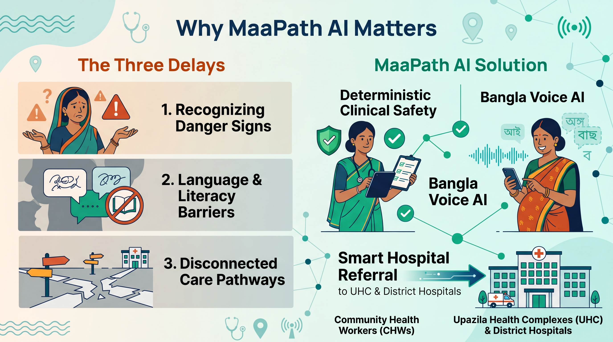

<p align="center">
  
</p>

<h1 align="center">MaaPath AI 🩺</h1>

<h3 align="center">AI-Powered Maternal & Newborn Safety Navigator for Bangladesh (LangGraph Multi-Agent System)</h3>

<p align="center">
  
  
  
  
  
  
  
  
  
  
  
  
  
  
  
</p>

<p align="center">
  <a href="https://maapath.onrender.com"><strong>🌐 Live Web App</strong></a> •
  <a href="https://maapath.onrender.com/docs"><strong>📡 FastAPI Swagger Docs</strong></a> •
  <a href="#-demo-walkthrough"><strong>🎮 Demo Walkthrough</strong></a>
</p>

---

## Contributors 👥

<p align="center">
  <a href="https://github.com/SoniaAkterown">
    
  </a>
  <a href="https://github.com/ashfiqadnan">
    
  </a>
  <a href="https://github.com/mdshadin751">
    
  </a>
</p>

---

# 🩺 MaaPath AI

**MaaPath AI** is not a standard pregnancy tracking app—it is an **AI-Powered Maternal & Newborn Care Coordination System** engineered for Bangladesh. It unites expectant mothers, community health workers (CHWs), and public healthcare facilities (**Upazila Health Complexes & District Hospitals**) through a **LangGraph Multi-Agent Architecture**, **Groq LLM (Llama 3.3 70B)** bilingual (**English & বাংলা**) Clinical RAG guidance, **real-time Bangla Voice (Speech-to-Text & Text-to-Speech)**, deterministic danger-sign triage, and automated ANC planning.

> **Live Application:** [https://maapath.onrender.com](https://maapath.onrender.com)  
> **API Documentation:** [https://maapath.onrender.com/docs](https://maapath.onrender.com/docs)

> ⚠️ **Crucial Medical Disclaimer:** MaaPath AI does **not** diagnose diseases and never replaces a licensed physician. It provides clinical alerts, educational guidance, and emergency hospital referral pathways strictly aligned with **WHO Antenatal Care (ANC) Guidelines** and **DGHS Bangladesh** maternal health protocols.

---
## 📸 Platform Screenshots

<details open>
  <summary><strong>🏠 Landing Page & Bilingual UI (EN / বাংলা)</strong></summary>
  <br>
  <p align="center">
    
  </p>
</details>

<details>
  <summary><strong>📖 Pregnancy: Basic Guide & Instructions</strong></summary>
  <br>
  <p align="center">
    
  </p>
</details>

<details>
  <summary><strong>1. Mother Dashboard</strong></summary>
  <br>
  <p align="center">
    
  </p>
</details>

<details>
  <summary><strong>2. Mother Registration</strong></summary>
  <br>
  <p align="center">
    
  </p>
</details>

<details>
  <summary><strong>3. Pregnancy Management</strong></summary>
  <br>
  <p align="center">
    
  </p>
</details>

<details>
  <summary><strong>4. Health Monitoring</strong></summary>
  <br>
  <p align="center">
    
  </p>
</details>

<details>
  <summary><strong>5. Risk Assessment</strong></summary>
  <br>
  <p align="center">
    
  </p>
</details>

<details>
  <summary><strong>6. ANC Planning</strong></summary>
  <br>
  <p align="center">
    
  </p>
</details>

<details>
  <summary><strong>7. AI Assistant (Bangla Voice & Clinical RAG)</strong></summary>
  <br>
  <p align="center">
    
  </p>
</details>

<details>
  <summary><strong>8. Smart Hospital Referral</strong></summary>
  <br>
  <p align="center">
    
  </p>
</details>

<details>
  <summary><strong>9. Newborn Care</strong></summary>
  <br>
  <p align="center">
    
  </p>
</details>

<details>
  <summary><strong>10. Health Worker Dashboard</strong></summary>
  <br>
  <p align="center">
    
  </p>
</details>

<details>
  <summary><strong>12. AI Agent Monitoring</strong></summary>
  <br>
  <p align="center">
    
  </p>
</details>

<details>
  <summary><strong>13. Notification Center</strong></summary>
  <br>
  <p align="center">
    
  </p>
</details>
<details>
  <summary><strong>🚨 Emergency SOS Modal (999 & 16263)</strong></summary>
  <br>
  <p align="center">
    
  </p>
</details>

## 🎯 Core 3-Pillar Strategy

1. **🔮 Predictive Intelligence:** Analyzes maternal vitals (BP, Hemoglobin, Blood Sugar, Weight) and obstetric history to flag potential clinical risks early (e.g., Pre-eclampsia, Gestational Diabetes, Anemia).
2. **🤖 Agentic Decision Support:** Orchestrates specialized AI agents via **LangGraph** and **Groq LLM** to coordinate ANC checkups, lab tests, and hospital referral pathways.
3. **❤️ Continuity of Care:** Provides end-to-end maternal and newborn tracking from early pregnancy registration through delivery preparation and postnatal **Bangladesh EPI** vaccination follow-ups.

---
---

## 💡 Motivation: Why MaaPath AI Matters

> **"No mother should lose her life simply because a warning sign went unrecognized or a hospital referral came too late."**

In Bangladesh—particularly in rural and peri-urban areas—most preventable maternal and newborn fatalities stem from the **"Three Delays"**:
1. **⏳ Delay in Recognizing Danger Signs:** Expectant mothers and families often miss early warning symptoms of life-threatening conditions like *Pre-eclampsia*, *Postpartum Hemorrhage*, or *Eclampsia*.
2. **🗣️ Language & Literacy Barriers:** Standard English pregnancy apps are inaccessible to rural mothers who need immediate, empathetic guidance in **spoken Bangla**.
3. **🏥 Disconnected Care Pathways:** Community Health Workers (CHWs), Upazila Health Complexes (UHCs), and District Hospitals often lack real-time coordination, causing critical delays during obstetric emergencies.

**MaaPath AI** bridges this gap by combining **deterministic clinical safety**, **Bangla Voice AI**, and **multi-agent care coordination**—turning any smartphone into a 24/7 maternal safety navigator aligned with **WHO** and **DGHS Bangladesh** standards.
<p align="center">
  
</p>

## 🏗️ LangGraph Multi-Agent Architecture

MaaPath AI uses a deterministic-first **LangGraph State Machine** so life-threatening danger signs bypass LLM latency and trigger immediate hospital escalation.

```text
Mother Registration / Vitals / Bangla-EN Text & Voice Query
                      │
                      ▼
            [ 1. Intake Agent ]
     (Calculates EDD, Gestational Week & Trimester)
                      │
                      ▼
        [ 2. Risk Screening Agent ]
  (Deterministic Clinical Guardrail: 7 Danger Signs)
                      │
         ┌────────────┴────────────┐
         │ Emergency Detected?     │ Routine / Safe
         ▼                         ▼
 [ 3. Referral Agent ]     ┌───────┴───────────────────┐
 (Immediate Escalation     ▼                           ▼
  to UHC / District  [ 4. ANC Planning ]   [ 5. Groq Clinical RAG ]
   Hospital & 999)    (WHO Visit Schedule)  (Llama 3.3 + WHO/DGHS)
```

### Specialized Agent Roles
- **Intake Agent:** Collects demographics, Last Menstrual Period (LMP), blood group, and obstetric history; auto-calculates Expected Delivery Date (EDD).
- **Risk Screening Agent:** Executes deterministic rule-based screening for 7 critical maternal danger signs (bleeding, severe headache, blurred vision, convulsions, high fever, severe abdominal pain, reduced fetal movement).
- **ANC Planning Agent:** Organizes WHO-recommended Antenatal Care (ANC) schedules, ultrasound milestones, and IFA/Calcium supplementation reminders.
- **Clinical RAG Agent (Groq Llama 3.3):** Answers bilingual (**বাংলা & English**) maternal health text & voice queries grounded in verified WHO & DGHS guidelines with automatic fallback safety.
- **Referral Agent:** Matches risk urgency with nearby **Upazila Health Complexes (UHC)** and **District Hospitals**, dispatching structured digital referral slips.
- **Follow-up & Newborn Care Agents:** Tracks missed appointments, postnatal maternal recovery, and **Bangladesh EPI** immunization schedules.

---

## ✨ 14 Integrated UI Modules (Bilingual EN / বাংলা + Voice AI + Dark/Light Mode)

| Category | Modules Included |
| :--- | :--- |
| **A. Mother & Pregnancy Care** | `1. Mother Dashboard` • `2. Mother Registration` • `3. Pregnancy Management` • `4. Health Monitoring` • `5. Risk Assessment` • `6. ANC Planning` |
| **B. AI, Referral & Newborn** | `7. Bangla Clinical RAG & Voice AI Assistant` • `8. Smart Hospital Referral` • `9. Newborn Care & EPI Tracker` |
| **C. Care Team, Admin & Ops** | `10. Health Worker Dashboard` • `11. Admin Dashboard` • `12. AI Agent Monitoring (Human-in-the-Loop)` |
| **D. Alerts & Preferences** | `13. Notification Center` • `14. Settings & Language` + **Global Emergency SOS Modal (999 & 16263)** |

---

## 🛠️ Technology Stack & Versions

- **Backend:** Python `3.11+`, FastAPI `0.115.0`, Uvicorn `0.30.6`, Pydantic `2.9.2`
- **Multi-Agent AI & LLM:** LangGraph `0.2.35`, LangChain Core `0.3.10`, **Groq API (`groq==0.11.0`, `llama-3.3-70b-versatile`)**, Verified WHO & DGHS Clinical RAG
- **Voice Interface:** Browser Web Speech API — Real-time **Bangla (`bn-BD`) & English (`en-US`) Speech-to-Text (STT)** and **Text-to-Speech (TTS)** audio responses
- **Database:** PostgreSQL (**Supabase Session Pooler**), SQLAlchemy `2.0.35`, `psycopg2-binary` (with automatic local SQLite fallback)
- **Frontend:** Responsive SPA built with HTML5, Tailwind CSS, Vanilla JavaScript, FontAwesome 6, and Google Fonts (*Inter* & *Hind Siliguri*)
- **Cloud Deployment:** Render Web Service ([maapath.onrender.com](https://maapath.onrender.com))

---

## 📁 Directory Structure

```text
MaaPath/
├── backend/
│   ├── main.py             # FastAPI server, REST APIs & frontend serving
│   ├── agents.py           # LangGraph multi-agent workflow & conditional routing
│   ├── clinical_rag.py     # Groq Llama 3.3 Clinical RAG + verified WHO & DGHS context
│   ├── database.py         # SQLAlchemy models (Mother, VitalLog, ANCVisit, Referral)
│   └── requirements.txt    # Python dependencies (FastAPI, LangGraph, Groq, SQLAlchemy)
├── frontend/
│   └── index.html          # Complete 14-module bilingual UI + Voice AI + Pregnancy Guide
├── LICENSE                 # Apache License 2.0
├── SECURITY.md             # Security & vulnerability reporting policy
└── README.md
```

---

## 🚀 How to Run Locally

1. **Clone the repository**
   ```bash
   git clone [https://github.com/SoniaAkterown/MaaPath.git](https://github.com/SoniaAkterown/MaaPath.git)
   cd MaaPath/backend
   ```

2. **Create a virtual environment & install dependencies**
   ```bash
   python -m venv venv
   # On Windows:
   venv\Scripts\activate
   # On macOS/Linux:
   source venv/bin/activate

   pip install -r requirements.txt
   ```

3. **Configure Environment Variables**
   Create a `.env` file inside `backend/`:
   ```env
   GROQ_API_KEY=gsk_your_groq_api_key_here
   DATABASE_URL=postgresql://postgres.[PROJECT-REF]:[PASSWORD]@[aws-1-ap-southeast-1.pooler.supabase.com:5432/postgres](https://aws-1-ap-southeast-1.pooler.supabase.com:5432/postgres)
   ```
   *(If `DATABASE_URL` is omitted, MaaPath AI automatically uses local SQLite `maapath.db`. If `GROQ_API_KEY` is omitted, it falls back to local verified WHO/DGHS responses.)*

4. **Start the FastAPI + LangGraph server**
   ```bash
   uvicorn main:app --reload
   ```
   - **Web App:** `http://127.0.0.1:8000`
   - **Interactive API Docs:** `http://127.0.0.1:8000/docs`

---

## 🎮 Demo Walkthrough

Test the end-to-end clinical workflow directly on [maapath.onrender.com](https://maapath.onrender.com):

1. **Bilingual & Theme Switch:** Toggle between **EN / বাংলা** and **Dark / Light Mode** from the top navbar to experience instant localization across all 14 modules.
2. **Smart Mother Registration (`Intake Agent`):** Click **"Register a Mother"**, enter an LMP date, and watch the live **EDD & Pregnancy Week** calculate automatically. Submit to persist the record in **Supabase PostgreSQL**.
3. **Deterministic Danger-Sign Triage (`Risk Screening Agent`):** Open **Module 5 (Risk Assessment)** and check any danger sign (e.g., *Severe Headache* or *Blurred Vision*) to trigger the immediate **HIGH EMERGENCY RISK** escalation banner.
4. **Bangla Voice & Groq Clinical RAG (`AI Assistant`):** Open **Module 7 (AI Assistant)**, click the **🎙️ Microphone button** to speak in Bangla or type *"মাথা ব্যথা ও ঝাপসা দেখলে কী করব?"* (emergency bypass) or *"আয়রন ও ক্যালসিয়াম কীভাবে খাব?"* to receive a **Groq Llama 3.3** WHO/DGHS-cited response read aloud via **Text-to-Speech**.
5. **Smart Hospital Referral (`Referral Agent`):** Open **Module 8**, filter between **Upazila Health Complexes** and **District Hospitals**, and dispatch a Digital Referral Slip.

---

## 📜 Security & Clinical Safety Policy

This project is open-source and structured for healthcare safety and transparency. See [SECURITY.md](SECURITY.md) for vulnerability reporting guidelines.

- 🛡️ **Emergency Helplines (Bangladesh):** Integrated quick-dial support for **999** (National Emergency Service) and **16263** (Shastho Batayon 24/7 Health Line).
- 🩺 **Human-in-the-Loop & Clinical Guardrails:** Deterministic danger-sign override ensures critical symptoms never wait on LLM generation; AI guidance is strictly educational and never replaces a licensed physician.

---

## 📄 License

This project is licensed under the **Apache License 2.0** — see the [LICENSE](LICENSE) file for details.
